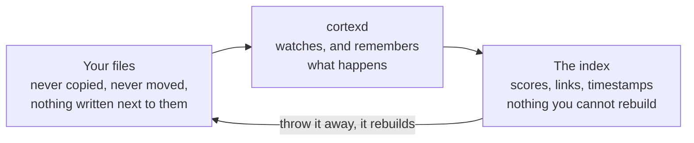
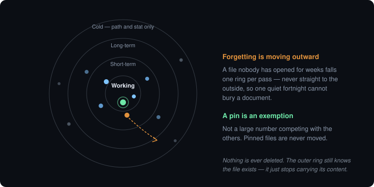
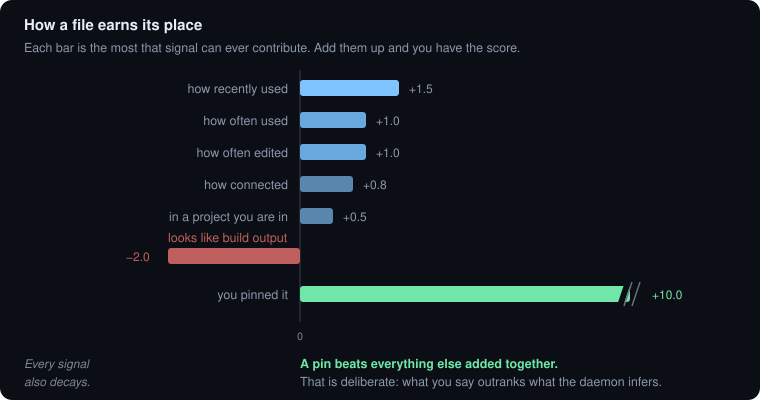
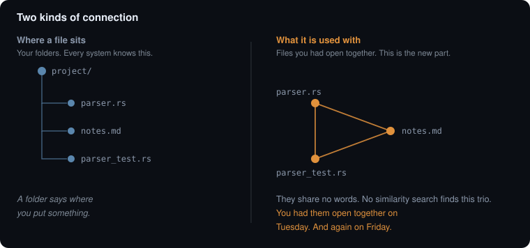
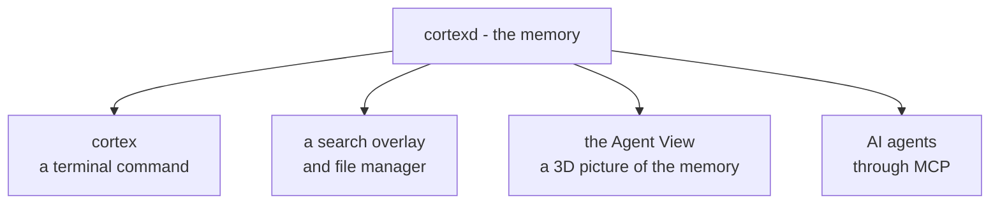
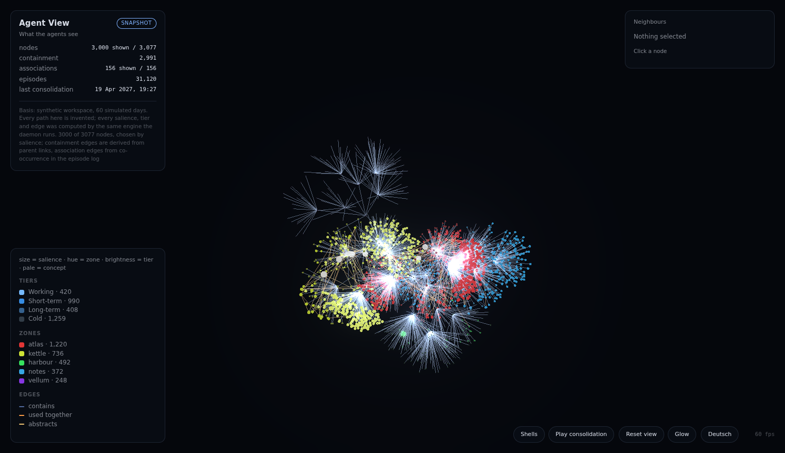

# Hippocampus

**A memory daemon for your filesystem — and the file manager that grew out of it.**

---

## Start here — what this is, in five minutes

**No background needed.** If you know what a folder is, you can read this part.

### The problem

Your computer stores your files perfectly and remembers **nothing about them**. It does not know
which three files you had open all last week, that a bug report and the config line that caused it
belong together, or that four thousand files in a build folder are not worth showing you. So you
end up *searching* for things you already know you have.

Hippocampus is a small background program that watches a folder and remembers those things.

### The one idea everything else follows from

> **Your files are the truth. The index is just notes about them, and you can throw the notes
> away whenever you like.**



That sounds like a technical detail. It is the whole design. Because the notes are disposable,
the program is allowed to **forget** — and forgetting is what keeps a memory useful instead of
turning it into a junk drawer. A system that holds the only copy can never dare throw anything
away, so it grows for ever and slowly stops being trustworthy.

### Forgetting means moving outward, not deleting

Every file sits in one of four rings. Use it and it moves toward the middle. Ignore it and it
drifts out, **one ring per pass** — never straight to the edge, so a quiet fortnight cannot bury
a document you were about to come back to. Even the outermost ring still knows the file exists.
Nothing is ever deleted.



**Pinned files are exempt.** Not "weighted heavily" — exempt. If you say a file matters, no amount
of guessing by the program can override you.

### How it decides what matters

Each file gets a score. The score is a plain sum of seven signals, and **each signal has a
ceiling**, so none of them can run away with the ranking. The score always comes with its
breakdown, so you can ask *why* something ranked where it did and get an answer instead of a
number.



All of it decays. Fifty uses two years ago count for less than three uses this week — which is
what "how much is this being used" has to mean in something that forgets.

### It connects files by *use*, not only by similarity

This is the part other tools do not have. A test and the code it tests may share no words at all.
A design note and the bug it predicted may be in different languages. Nothing about their
*content* links them. What links them is that you had them open together.



When the same handful of files keeps coming up together, Hippocampus gives the group a name —
a **concept** — taken from what those files have in common and the rest of your disk does not.
That is how "these three files are related" becomes "this is the parser work".

> One deliberate rule: a burst that touches more than twelve files at once is thrown away
> entirely. That is a build running, not a person working, and letting builds create connections
> would tangle everything to everything.

### What happens while you are not looking

Once a night — or whenever you ask — it does one pass:


The report is written for a person, not for a log file. It says how much it replayed, what it
connected, what changed ring, how many pinned files it left alone — and, every single time, a
section naming **what it deliberately did not do**. A tool that only lists its successes is how
you end up believing it is further along than it is.

### Who talks to it

The memory is the program. Everything else is a window onto it, and no window can know something
the others cannot.



The 3D view is the one worth seeing, because it is where the memory becomes checkable by looking.
Colour is the project, brightness is the ring, size is the score, and the pale nodes are the
concepts it named by itself. Switch to shell layout and the four rings from the first picture
appear — with the forgotten files visibly on the outside.



<sub>A generated example, so it can be published — but every score, tier and connection in it was
computed by the same engine the daemon runs. `cargo run -p brain-sim` makes it from a seed.</sub>

**Agents get read access to your files and write access to the memory** — they can annotate, pin
and link, but every change to an actual file needs an allow-list, a dry run you confirm first, and
lands in an undo journal. Everything an agent does is logged, and one switch turns the whole
agent surface off.

### What you actually type

```sh
cortex index ~/Documents     # look at a folder
cortex search "that thing"   # find something - paths, words, and meaning
cortex explain "that thing"  # ask why a result ranked where it did
cortex pin <file>            # this one matters, never forget it
cortex consolidate           # do a pass now, and print the report
```

Search answers in well under a tenth of a second, and **no AI model sits in that path**. The
benchmark is `fzf`, not a chat window. Models only reorder results *after* they are already on
screen, and if there is no model at all, everything still works.

### What it never does

- **Never copies your files** and never writes anything next to them.
- **Never imposes a folder structure.** Your filesystem stays exactly as you left it.
- **Never goes online by itself.** A fresh install makes zero outbound connections. Nothing is
  downloaded until you ask for it.
- **Never opens what it should not.** Keys, credentials, browser profiles, password stores and
  the like are on a deny-list checked *before* anything is read — not after.

### The five words you will keep seeing

| Word | Means |
|---|---|
| **node** | one thing in the memory: a file, a folder, or a concept |
| **episode** | one recorded event: a file was created, opened, changed, searched for |
| **salience** | the score above — how much something is worth remembering right now |
| **tier** | which of the four rings something is in |
| **consolidation** | the pass in the diagram above |

**Where to go next:** the rest of this README is the practical detail. For the argument behind the
design, read [`docs/paper/FORGETTING-IS-THE-FEATURE.md`](docs/paper/FORGETTING-IS-THE-FEATURE.md).
To build something like it yourself, [`docs/paper/BUILD-PROMPT.md`](docs/paper/BUILD-PROMPT.md) is
a complete specification with acceptance criteria.

---

> Status: early, and the search works. The daemon watches a filesystem, keeps a rebuildable index
> of it, and searches paths, words and **meaning** — a query finds documents that share no word
> with it, in German or English. A fuzzy path match takes about a millisecond over a hundred
> thousand files, a content query fifteen, the whole hybrid query about twenty, and a
> cross-encoder reorders the top results seventeen milliseconds after they are already on screen.
> Recall is measured against a checked-in goldset rather than asserted, including the one
> criterion it currently fails. See `docs/03-PROGRESS.md`.

---

A filesystem is already a memory. It is just a very bad one: it stores content, but no
**episodes** (when, why, in what context), no **salience** (what matters), and no
**associations** (what belongs with what). That is why people *search* for files instead of
*remembering* them.

Hippocampus inverts the priority:

> The file manager is not the application. It is one of several views onto a local memory daemon.

The daemon — `cortexd` — watches the filesystem, records what happens, indexes what matters,
condenses it over time, and forgets what stopped being relevant. A CLI, a GUI, and an MCP server
for AI agents are equal clients on top of it.

## What makes it different

**The index is a cache, never a data store.** Hippocampus stores pointers, offsets, hashes and
relationships. It never stores a copy of your files, never writes sidecar files next to them,
and never imposes a folder structure. Delete the index and it rebuilds itself. Your filesystem
stays fully usable without this program.

**It forgets.** Almost every "second brain" project only accumulates, and after eighteen months
it is large, slow, and full of noise that its owner no longer trusts. Hippocampus decays
salience over time and demotes cold material to a metadata-only tier. Pinned items are immune.
Forgetting is safe precisely because the index is reconstructible.

**No AI in the hot path.** The benchmark for search is `fzf` and Spotlight, not a chat window.
Lexical and vector retrieval return results in under 80 ms; models then *improve* the ranking
progressively. The result list is never empty and never blocked on a model.

**Agents are first-class, and sandboxed.** The MCP surface gives agents read access to files and
write access to the memory. Filesystem mutations require an allow-list, a confirmed dry-run, and
land in an undo journal. An agent with unchecked `fs.move` over an indexed home directory can do
more damage in 200 ms than a backup undoes.

**Nothing leaves your machine.** A fresh install makes zero outbound connections. No telemetry,
no update checks, no cloud models. Federation with a remote memory is optional and additive —
the system is complete without it.

## Status and roadmap

| Milestone | Content | State |
|---|---|---|
| M0 | Daemon skeleton, schema, JSON-RPC socket, CLI | **done** |
| M1 | Filesystem watcher, metadata index, episodes, trigram path search, zones | **done** |
| M2 | Extraction, chunking, embeddings, hybrid search | **done** |
| M3 | Agent Surface: MCP, policy engine, undo journal | **done** |
| M4 | Search overlay (first GUI) | |
| M5 | Salience, decay, tiering, consolidation | |
| M6 | The full file manager | |
| M7 | Federation with a remote memory | |
| M8 | Brain-state visualisation | |
| M9 | Packaging and release | |

Details, including the executable definition of done for each milestone, are in
`docs/01-BUILD-PROMPT.md`.

## Building

Requires Rust 1.85 or newer.

```sh
git clone <this repository>
cd hippocampus
./scripts/setup-dev.sh      # installs the git hooks
cargo test --workspace
cargo build --release
```

## Trying it

```sh
# Start the daemon (use --root to keep everything in one throwaway directory)
./target/release/cortexd --root /tmp/hippocampus-demo &

# Index something, metadata only
./target/release/cortex --root /tmp/hippocampus-demo index ~/Documents

# See whether the watcher is keeping up
./target/release/cortex --root /tmp/hippocampus-demo watch status

# Compare the index against the filesystem and repair any drift
./target/release/cortex --root /tmp/hippocampus-demo reconcile

# See the spatial zones and their colours
./target/release/cortex --root /tmp/hippocampus-demo zones

# Search it — paths and, inside configured content roots, what the files say
./target/release/cortex --root /tmp/hippocampus-demo search report

# Ask why something ranked where it did, or why it did not appear at all
./target/release/cortex --root /tmp/hippocampus-demo explain report ~/Documents/report.md

# See how far content extraction has got
./target/release/cortex --root /tmp/hippocampus-demo extract

# Semantic search needs a model. Nothing is downloaded until you ask for it.
# --gpu fetches the CUDA build (needs a CUDA runtime and cuDNN, not just a driver);
# --reranker adds the cross-encoder that reorders results after they are shown.
./target/release/cortex --root /tmp/hippocampus-demo model fetch --gpu --reranker
./target/release/cortex --root /tmp/hippocampus-demo model

# Throw the index away and derive it again from the filesystem
./target/release/cortex --root /tmp/hippocampus-demo rebuild

# See what it knows
./target/release/cortex --root /tmp/hippocampus-demo status
```

Every command takes `--json` for scripting and for agent use.

Content is only read inside roots you name explicitly. Add them to the configuration file:

```toml
[index]
metadata_roots = ["/home/you"]     # paths and stats — cheap, broad
content_roots  = ["/home/you/Documents", "/home/you/Projects"]
```

Metadata indexing may span a whole home directory; reading what is *inside* a file is opt-in and
empty by default (hard rule R3). The deny-list applies before either, and cannot be shrunk.

**Downloads.** A fresh install makes no outbound connection at all. `cortex model fetch` is the
only command that does, it says what it is about to fetch and from where, and every file is
verified against a checksum pinned in the source. Without a model the search still works — it
just has no semantic arm, and says so when you ask it why.

## The search overlay

The first GUI: a launcher that starts hidden with your session and is summoned by a key your
compositor binds to `hippocampus --toggle`.

```sh
cd ui && npm install
npm run tauri build -- --no-bundle
../target/release/hippocampus
```

It needs the daemon running, and it is built through the Tauri CLI rather than with
`cargo build` — `ui/README.md` says why that distinction bites.

Image, PDF and video previews come from `cortex-preview`, a separate process that shares the
desktop's thumbnail cache. It is meant to be killable: it decodes untrusted bytes, so a
malformed file costs a preview rather than the window.

## Letting an agent use it

The brain is exposed to agents over MCP. Wire it into Claude Code with:

```bash
claude mcp add hippocampus -- /path/to/cortex-mcp --actor claude
```

The server needs the daemon running; it is a bridge, not a second copy of the brain. What an
agent gets is eighteen tools: search and recall, reading and listing, annotating and linking,
and — gated — writing, moving and trashing.

**Every mutation is planned before it happens.** A gated tool called without a plan id changes
nothing and answers with what it *would* do; the agent calls again with that plan's id to apply
it. Plans expire, are checked against the filesystem when they are applied, and cannot be spent
on a different file than the one they describe. Everything an agent changes is reversible with
`cortex undo`, and everything an agent asks for — including everything it was refused — is in
`cortex audit`.

Agents may write to the brain freely and to the filesystem only inside an allow-list, which is
empty by default:

```toml
[agent]
enabled = true
write_allowlist = ["/home/you/Projects/scratch"]
require_dry_run = true
```

Two switches turn things off, and both survive a restart:

```bash
cortex agent-surface off   # agent tools refuse; cortex-mcp will not even start
cortex pause               # stop watching and indexing; the index still answers
```

Without `--root`, the daemon uses the XDG locations: configuration in
`~/.config/hippocampus/`, index in `~/.local/state/hippocampus/`, socket in
`$XDG_RUNTIME_DIR/hippocampus/`.

## What it deliberately does not do

- **Index your secrets.** `~/.ssh`, `~/.gnupg`, `.env` files, keys, browser profiles and
  password stores are excluded by a deny-list that configuration cannot switch off.
- **Read file contents by default.** Metadata indexing may cover your whole home directory;
  content extraction only happens inside roots you explicitly configure.
- **Talk to the network.** Not until you turn something on.
- **Decode untrusted bytes in the daemon.** Image, PDF and video previews run in a separate
  process that shares the desktop's thumbnail cache. A malformed file kills a helper; search
  does not notice.
- **Let an agent loose on your files.** Agents get read access and an empty write allow-list.
  Mutations need a plan you can inspect, leave an undo entry, and are logged whether they were
  permitted or refused.

The full set is in `docs/05-HARD-RULES.md`.

## Contributing

Read `CLAUDE.md` first — it is the entry point for anyone (or anything) working in this
repository, and it explains the documentation layout and the rules that are not negotiable.

## License

Not yet chosen. See decision D13 in `docs/02-DECISIONS.md`. Until then, all rights reserved.
